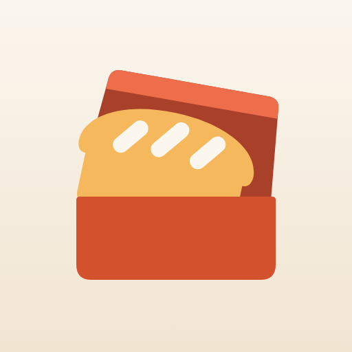
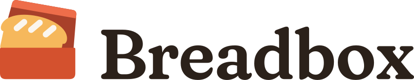

# Breadbox

The app is called **Breadbox**. A breadbox is where a household keeps its daily bread, and that is
what the app keeps: the family's recipes (the "box" is the recipe box that gets handed down), the
week's shopping (bread is the staple on every list) and the cupboard (a breadbox is kitchen
storage). Leave the "bread is money" pun out of copy: see the trademark note below.

It replaces **Waxwing** (October to November 2026), whose bird icon testers said "doesn't seem
like a food app", and before that the working name "Meal Planner", which described the app but
could never be anyone's.

- **App Store name:** `Breadbox` if App Store Connect accepts it, otherwise
  `Breadbox: Family Recipes` (24 characters). See the checks below.
- **Subtitle:** `Family recipes & grocery list`
- **Home-screen label:** `Breadbox`
- **One-line explainer** (About, App Store description): *A breadbox is where a family keeps its
  daily bread. This one keeps your recipes and the week's shopping.*

## The family: one bird per app, and one kitchen thing

Every app gets its own name. The others are real birds whose real habit is that app's job; the
theme is never spelled out in a product name. The app the whole household uses is the exception:
it is named for a thing in the kitchen, because a bird on its icon read as a bird app (see the
icon below). Shorebirds are kept for the beach-house apps.

| App | Name | Why |
| --- | --- | --- |
| Recipes & groceries (this one) | **Breadbox** | Where a household keeps its daily bread. Was Waxwing until November 2026 |
| Stock league (friends and AIs on the real market) | **Rook** | The cleverest corvid, loud trading-floor colonies, and the chess piece people play against machines |
| Personal finance | **Nuthatch** | Tucks seeds into bark all autumn so there is food in winter |
| Beach-house wall dashboard | **Curlew** | Works the tide line — what the dashboard watches |

**Rules** (so the set stays a set):
1. A real bird, chosen for what it *does*, not just how it looks. The one exception is the
   household's kitchen app, which is named for a kitchen thing: Breadbox.
2. Shorebirds (Curlew, Godwit, Plover, Turnstone, Sanderling…) only for the beach-house apps.
3. Never a name that is already a big app or brand in the same category, and never a famous bird
   (Robin, Finch, Wren, Lark, Swift, Sparrow, Starling, Kingfisher, Merlin, Raven, Magpie are
   all crowded).
4. Name products, never features.

**Reserve list** (screened lightly, re-check before use): Waxwing (free again), Siskin, Linnet,
Godwit (trips — it flies 11,000 km non-stop), Dipper (fitness — walks underwater), Nightjar
(sleep), Bowerbird (photos and collections), Weaver, Lyrebird, Honeyguide, Turnstone, Brambling.

The waxwing can live on inside this app, as an About line or an empty-state drawing, but not on
its icon: in the blind test, every viewer of a waxwing perched on a loaf named the bird first.

Rook carries one caution: "to rook" means to swindle. The chess meaning wins for most people and
the league is paper money, but keep investment-advice wording well away from it. An unscreened
fallback is Skua (the seabird that chases others for their catch).

## The icon

A golden pan loaf climbing out of a tomato-red bread box whose flat lid is flung open behind it,
on a paper tile. Three flat shapes, back to front: the lid (with its lighter front lip), the loaf
(with three cream scores) and the box.

| | |
| --- | --- |
| Tile | `#FBF6EE` to `#F1E5D2`, top to bottom (the app's paper) |
| Lid | `#A8402A`, its front lip `#EE6D4A` |
| Loaf | `#F6B85C`, scores `#FBF6EE` |
| Box | `#D4512E` (the Tomato theme's accent) |
| Dark appearance | no tile (iOS's own dark background shows through); lid `#B24A2E`, lip `#F07452`, loaf `#F2B35A`, scores `#F6EDE0`, box `#DA5832` |
| Tinted appearance | on black; lid `#505050`, lip `#717171`, loaf `#C4C4C4`, scores `#F5F5F5`, box `#8E8E8E` |
| Favicon tile | `#F8F0E3`, flat, corners rounded |

Why it looks like this: in November 2026 the waxwing icon and ten bread drawings were
blind-tested. AI viewers saw unlabelled iPhone home screens and said what each app was for. The
waxwing was read as a bird-watching app 3 times out of 3, and every bread drawing as food. A
second round drew nine versions of a loaf in a red bread box, the theme picked for the name, and
this one was chosen from them. All three viewers read it as a bread or bakery app; one named a
bread box and one hedged "lunchbox or treasure chest". (A front-on roll-top bin said "bread box"
more often, 4 times out of 4, and roll-tops drawn with their arch were taken for ovens.) The box is
the default theme's tomato and the tile is the app's paper, so the icon looks like the app it
opens, and the light tile keeps it apart from the solid red and orange food icons. Keep it off
forest green: another app called Breadbox uses it, with an open lunchbox.

It follows Apple's iOS 26 icon guidance: front-on, three flat shapes, no text, no painted shadows
or shine (the lid's lighter band is its front lip, a flat colour), and everything inside a centred
circle of radius 410 of 1024 (the drawing reaches 403), so the same art also works as a maskable
web icon.

Source art lives in `web/scripts/brand/`:

- `app-icon.svg`: the icon (1024, full bleed).
- `app-icon-dark.svg` and `app-icon-tinted.svg`: the iPhone's Dark and Tinted appearances.
- `favicon.svg`: the drawing on a rounded paper tile, because browsers don't round favicons.
- `glyph.svg`: the mark inside the apps (below).
- `icon-layers/`: the icon split for Icon Composer (`background.svg`, `1-lid.svg`, `2-loaf.svg`,
  `3-box.svg`); each file's comment lists its fills for Default, Dark and Mono.
- `logo/`: the logo (below).

`node web/scripts/brand/render-icons.mjs` regenerates every PNG with headless Edge or Chrome:
the iPhone's `AppIcon.png`, `AppIcon-Dark.png` and `AppIcon-Tinted.png` (1024) and the web's 512,
192 and 180, and copies the favicon to `web/public`. It checks they are opaque RGB (the App Store
rejects an icon with alpha; if a browser ever writes one, it is dropped with ffmpeg when installed,
or by the script itself), except the Dark one, which must keep its transparency so iOS can draw
its own dark background. Nothing is written until every render has passed. After changing the
art, bump the `?v=` on the icon links in `web/index.html` and `web/public/manifest.webmanifest`.
The manifest lists the 192 and 512 PNGs again as `maskable`, which is safe because the drawing
stays inside the safe circle.

The script only rasterizes the three `app-icon*.svg` files and copies `favicon.svg` as it is, so
a change to the drawing has to be made by hand in every copy: the lid, loaf and box paths appear in
`app-icon.svg`, `app-icon-dark.svg`, `app-icon-tinted.svg`, `icon-layers/` and (rescaled) the
colour logos and `logo/mark.svg`; `favicon.svg` is the same drawing rescaled onto its own tile;
and `glyph.svg` is pasted into both `AppGlyph.imageset/appglyph.svg` files (filled `#000000`), the
`mark` entry in `web/src/components/icons.tsx` (scaled by .375) and the `-mono` logos. The glyph's
gaps were traced from a 4096 px render of the drawing, so a new drawing needs a new glyph.

Apple now prefers a layered Icon Composer file for the iOS 26 and 27 glass look. That needs a
Mac: in Icon Composer, use the background as the document's fill (none in Dark, so the system's
dark background shows, as in the PNG; black in Mono) and the lid, loaf and box as three groups,
set their Dark and Mono fills from the layer comments, and save it as
`ios/MealPlanner/AppIcon.icon` next to `Assets.xcassets`. If the glass's own edge light makes the
lid's lip look doubled, paint the lip in the lid's colour in that file. Xcode then uses it instead
of `AppIcon.appiconset` and builds the App Store icon and the images for older iOS versions from
it. Delete `AppIcon.appiconset` so there is one source, remove its three entries from `OUTPUTS`
in `render-icons.mjs` (or the next run recreates the folder), and rewrite the icon section of
`ios/README.md`. Until then, iOS applies its glass to the PNGs itself.

**The mark inside the apps** is `glyph.svg`: the same drawing in one colour. Where one shape sits
in front of another, the one behind is cut back by a gap, and the three scores are holes (each
wound opposite to its outline, so it fills the same under either fill rule). It sits on the
theme's accent tile on the sign-in screen and the share sheet (web: `<Icon name="mark">`; iPhone:
`AppGlyph.imageset`, filled `#000000`, in the app's asset catalog and the share extension's own).
It reads at the share sheet's 16 pt on a phone; on a 1x screen below about 24 px the scores blur,
but the box and loaf still read. The chef's hat stays as the placeholder for a recipe with no
photo.

## The logo

`web/scripts/brand/logo/` holds the logo: the icon's drawing with "Breadbox" set in Fraunces 600
(`SOFT` 100, `WONK` 0, optical size 48, letter-spacing −0.01em, kerned as browsers set it) and
turned into outlines, so it never depends on the font being installed.

- `logo-horizontal.svg`: the box sits on the word's baseline and rises to 1.6 cap heights. The
  usual one.
- `logo-stacked.svg`: the box centred over the word, for square spaces.
- `-dark` versions for dark backgrounds (the word in `#F6EDE3`, the drawing a touch brighter, as
  in the icon's Dark appearance), and `-mono` versions in one colour (`currentColor`: the app's
  one-colour mark and the word) for photos, coloured backgrounds and one-colour printing.
- `mark.svg` (the drawing alone, without its tile) and `wordmark.svg` (the word alone,
  `currentColor`).

On light backgrounds the word is ink `#2B211A`. Leave at least the B's height clear around the
logo; below about 120 px wide for the horizontal logo (80 px for the stacked one) use the app icon
instead. Don't recolour the drawing, re-set the word in another font next to it, or put the
drawing on any tile but the icon's paper.

In the apps the name is set live in each theme's own title font, so it looks different in
Blueberry or Nordic; the logo files are for artwork, the README, the App Store and print.

## Checks done (8 November 2026)

- **App Store:** an iPhone app called exactly "Breadbox" (id6798416315, Food & Drink, from a
  developer in Munich: a friends' food-photo feed with recipes, a cookbook and a shopping list)
  has been live in Germany since 12 September 2026 and in the US, UK and Canada since 21 October,
  with a German-only listing. App names are unique per localization, so a plain "Breadbox" in
  English (U.S.) may or may not be accepted; "Breadbox: Family Recipes" is unused. Also on the
  stores: BreadBox Coffee (a café's loyalty app), Breadbin (a Commodore 64 emulator, so Breadbin is
  no fallback) and a bakery-ordering "Breadbox" on Google Play.
- **US trademarks:** no live or pending mark covers recipe, grocery-list, meal-planning or pantry
  software. The one to watch is BREADBOX, Reg. 8013722 (Junior Achievement USA, classes 41 and 42:
  web-based budgeting and financial-education software), so describe receipts and prices as
  grocery price tracking, never "budgeting" or "spending". Older software marks (Groupon's point
  of sale, Breadbox Computer Company, Bread Box Media) are dead. The UK and EU marks found are for
  food, restaurants (SSP's BREAD BOX) and optics. In Germany an app's title can be protected
  without registration (the BGH's *wetter.de* ruling), which matters only if the app is offered
  there.
- **Domains:** breadbox.com, .app, .io, .co and .food, getbreadbox.com and .app, breadboxapp.com
  and breadboxrecipes.com are taken. breadbox.family, .kitchen, .recipes and .cooking and
  breadboxfamily.com were free (registry RDAP; prices not checked). The app keeps working at
  meals.gehan.cloud.
- **Handles:** @breadbox is taken nearly everywhere; @breadboxkitchen looked free on Instagram,
  X, TikTok and Bluesky.
- **The word:** "breadbox" is American; Britain, Ireland and Australia say "bread bin" but
  understand it. On the App Store "bread" mostly means bakery ordering and sourdough tools, so
  always pair the name with "Family Recipes". German and Dutch speakers hear "lunchbox" (Brotbox,
  broodtrommel).

This is a screening, not legal advice. Before a public launch, get a proper clearance search (US
classes 9 and 42, including the Junior Achievement mark, and Germany if the app is offered there).

## Still to do by hand

- App Store Connect → App Information → Name: "Gehan Meal Planner" → "Breadbox", or
  "Breadbox: Family Recipes" if that is refused (30 characters max, unique per localization).
- On a Mac, optionally: the Icon Composer file described above.
- Show the icon to a few people outside the beta for five seconds each and ask what the app is
  for; the blind tests used AI viewers, not people.
- iPhones that added the web app to their home screen keep the old icon and label until it is
  removed and added again; iOS never refreshes a web clip.
- Nothing internal changes: the bundle id `cloud.gehan.mealplanner`, the Keychain service, the
  `mealplanner` URL scheme, the Docker project and database names and the domain all stay,
  because renaming any of them would sign people out, orphan data or break links.
