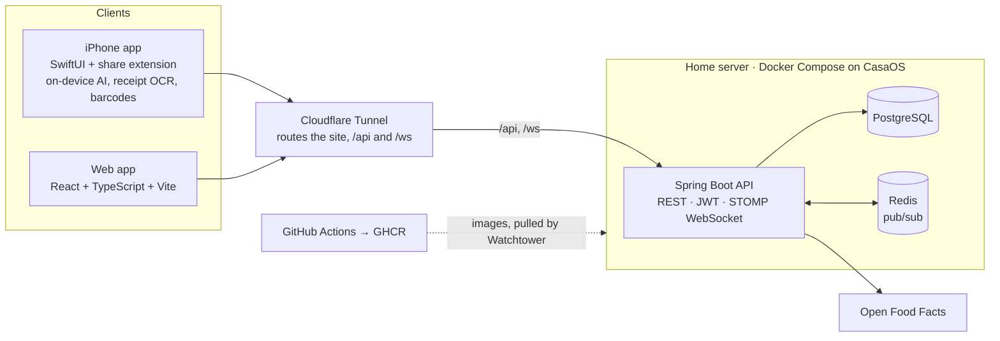

<p align="center">
  
</p>

<h1 align="center">Waxwing</h1>

<p align="center">
  <b>A family recipe box and one shared grocery list for the whole household.</b><br>
  Native iPhone app and web app, one Spring Boot backend, self-hosted on a home server.
</p>

<p align="center">
  <a href="docs/media/waxwing-demo.mp4">
    
  </a><br>
  <sub>21-second tour. Click it for the full video with sound.</sub>
</p>

<p align="center">
  
  
  
  
  
  
  
</p>

---

## At a glance

| | |
| --- | --- |
| **What** | Recipes, a live shared grocery list, optional meal planning and cupboard, and grocery prices read from scanned receipts |
| **Status** | Private beta: **5 households, about 20 testers** on TestFlight, running on a home server I built. The web app is at [meals.gehan.cloud](https://meals.gehan.cloud), but it is invite-only, so you can't sign up there. The video above shows it |
| **Why** | In my house, deciding what to cook and then writing the list took forever, and several people sharing one handwritten list never worked. It has replaced all of that for my family. By our estimate it saves my mom 5+ hours a week |
| **Size** | ~133k lines (Java 40.7k, TypeScript 46.9k, Swift 45.4k), 182 REST endpoints, 38 tables, 546 backend tests, 57 Playwright spec files |

## What it does

- **Recipes** live in drawers (Breakfast, Lunch, Dinner…) with tags the household makes up. There are three ways in:
  - import from a recipe link, using the page's own schema.org data;
  - paste text from anywhere and let the iPhone's on-device AI structure it;
  - share into the app from any other iPhone app.
- **One grocery list per household**, updated live in the web app and reloaded by the iPhone app whenever it's opened or pulled down. Amounts are added up by ingredient, and the list fills from a recipe or from the week's plan.
- **Households** join by invite link or QR code. Meal planning and cupboard tracking are optional, switched on per household.
- **Kitchen-aware suggestions:** the household saves which machines it has (oven, air fryer, slow cooker…). Meal ideas and generated plans only pick recipes it can make. Plans can also aim at daily calorie and protein targets.
- **Prices from receipts:** scan a receipt and every line becomes a price at that store.
  - Barcodes fill in lines the till abbreviated past reading.
  - Each item shows its last price at every store, with the cheapest marked per egg, lb or fl oz.
- **Also:** nutrition facts, a map of grocery stores, restock reminders, themes, and a small [integration API](INTEGRATION.md) for home dashboards.

## Architecture



- **One API, two clients.** The Spring Boot backend serves the React web app and the native iPhone app over the same REST API. Every household's data is scoped to that household.
- **Live updates.** A change to the grocery list is published to Redis. Every backend instance relays it to a STOMP WebSocket topic for that household, so open web clients update without a refresh. The iPhone app reloads the list when it's opened or pulled down.
- **AI on the device, not in the cloud.** Recipe parsing and receipt-line naming use Apple's on-device Foundation Models: the model runs on the phone, so there are no API keys and no per-request cost.
- **Delivery.** GitHub Actions builds the backend and frontend images and pushes them to GHCR. Watchtower on the home server rolls them out, and a Cloudflare Tunnel publishes it without opening ports, sending `/api` and `/ws` straight to the backend. iPhone builds go to TestFlight through [`ios/release.sh`](ios/release.sh).

## Engineering highlights

**1. Live sync for a list several people edit at once.** A grocery list is worth sharing only if everyone sees the same list now. Writes go through the API, and an event is published to Redis ([`realtime/`](backend/src/main/java/com/gehan/mealplanner/realtime/)). Each instance's subscriber pushes it to `/topic/households/{id}/grocery-list` over STOMP. The web client applies it on arrival. After a dropped connection (a phone asleep in a pocket), it subscribes first and then refetches, so no change made in between is lost ([`GroceryListPage.tsx`](web/src/pages/GroceryListPage.tsx)).

**2. Reading real store receipts, with no store API.** My local store has no pricing API, so prices come from receipts. The phone reads the text with Vision. The server's [`ReceiptReader`](backend/src/main/java/com/gehan/mealplanner/receipts/ReceiptReader.java), tuned against real receipts, then:
- fixes the text recognition's predictable slips: look-alike Cyrillic or Greek letters, `50Z` read as 5 oz, glued price flags;
- tells weighed lines from counted ones, and reads pack sizes and discounts;
- folds a chain's branches together.

The household's corrections are remembered by a normalized key, so the next receipt comes out right without any AI. Prices are compared per unit ([`UnitPrice.swift`](ios/MealPlanner/Features/Receipts/UnitPrice.swift)), so 18 eggs for a little more correctly beats 12 for less.

**3. On-device AI that can't make things up.** Apple's model is small, so it only extracts and picks; it never writes freely.
- Guided generation (`@Generable`) fixes the shape of each answer.
- A receipt line can only be named as one of the household's own groceries, or as "something else".
- Every answer passes validation ([`ReceiptAssist.swift`](ios/MealPlanner/Features/Receipts/ReceiptAssist.swift)). A refusal, an error or an answer that isn't on the list falls back to the rule-based result, which is also what phones without Apple Intelligence see.

The rules are plain Swift with no app code, so [`ios/checks`](ios/checks/) tests them with a scripted stand-in model, without a simulator.

**4. Meal plans you can check by hand.** [`TargetPlanner`](backend/src/main/java/com/gehan/mealplanner/mealplans/TargetPlanner.java) is plain arithmetic, not a black box. Each meal slot tries every allowed recipe at portions from ½ to 3 servings and scores it on:
- distance from the slot's calories, and protein shortfall;
- how well it fits the meal, and the household's preferences;
- repeats within the plan.

Dinner makes up whatever the day still needs. Recipes the kitchen's machines can't make, or whose nutrition can't be fully counted, are never chosen.

## Testing and delivery

- **Backend:** 546 JUnit tests running against a real PostgreSQL database, not mocks.
- **End to end:** 57 Playwright spec files, covering the API (28), the UI at iPhone size (28) and a screen inventory (1).
  - [`ios-contract.spec.ts`](e2e/tests/api/ios-contract.spec.ts) pins the exact JSON the iPhone app decodes, so a backend change can't silently break the app.
- **iPhone:** an [`ios/checks`](ios/checks/) harness for the on-device AI and matching rules.
  - [`release.sh`](ios/release.sh) archives and uploads to TestFlight, and the build number is the commit count.
- **CI/CD:** [GitHub Actions](.github/workflows/) builds and publishes both Docker images on every push to `main`. Production runs from [`docker-compose.prod.yml`](docker-compose.prod.yml) on CasaOS with Watchtower and a Cloudflare Tunnel; see [DEPLOY.md](DEPLOY.md).

## Tech stack

| Layer | Tech |
| --- | --- |
| Backend | Java 21, Spring Boot 4.1 (Web MVC, Data JPA/Hibernate, Security with JWT, WebSocket/STOMP, Validation, Actuator), Maven |
| Data | PostgreSQL 16, Redis 7 |
| Web | React, TypeScript, Vite, Tailwind CSS, React Router, STOMP over SockJS, zxing-wasm |
| iPhone | Swift, SwiftUI, Share Extension, Foundation Models, Vision and VisionKit, AVFoundation, MapKit, PhotosUI |
| Outside data | Open Food Facts (barcodes, nutrition), schema.org Recipe data on recipe sites |
| Testing | JUnit, Spring Boot Test, Playwright |
| Infra | Docker, Docker Compose, GitHub Actions, GHCR, CasaOS, Watchtower, Cloudflare Tunnel (Kubernetes manifests in [`k8s/`](k8s/), unused) |

## How I built it

I own the product, the architecture and quality:
- I decided what Waxwing does, from how my family actually plans and shops.
- I chose the stack and how the pieces fit together.
- I review and test every change on real iPhones, with bug reports from the beta testers.

The code was written with [Claude Code](https://claude.com/claude-code) as an AI pair programmer, working to my direction; most commits carry its co-author line. I'd tried to build this app before, and working this way is what let me finish and ship it.

## Repository layout

| Path | What |
| --- | --- |
| [`backend/`](backend/) | Spring Boot 4 / Java 21 API: auth, recipes, groceries, plans, receipts, live sync |
| [`web/`](web/) | React + Vite + Tailwind web app, mobile-first |
| [`ios/`](ios/) | Native SwiftUI app and share extension ([its own README](ios/README.md)) |
| [`e2e/`](e2e/) | Playwright API and UI tests |
| [`docker-compose.prod.yml`](docker-compose.prod.yml) | The production stack, from prebuilt GHCR images |
| [`deploy.sh`](deploy.sh) | Pull and restart on the server, with a health check |
| [`k8s/`](k8s/) | An unused Kubernetes alternative to the Compose deployment |

## Running it locally

Needs Docker, JDK 21 and Node 22.

```bash
./dev.sh start     # Postgres + Redis in Docker, the Spring backend, and Vite
./dev.sh status
./dev.sh stop
```

Then open the URL it prints. On first run the app walks you through creating the first household
and account. The iPhone app builds in Xcode from [`ios/`](ios/).

<sub>The name and icon are explained in [BRAND.md](BRAND.md). The app used to be called Meal
Planner, and the internal names, bundle id and domain still say so.</sub>
